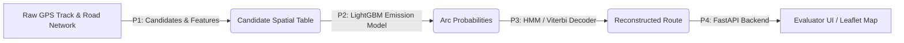

# PathSnap: Distributed GPS Trajectory Map-Matching System
**PES University (RR Campus) — UE24CS352A Machine Learning Hackathon**

[](https://www.python.org/)
[](https://fastapi.tiangolo.com/)
[](https://leafletjs.com/)
[](LICENSE)

PathSnap (MapSnap) is a high-performance, distributed GPS trajectory map-matching engine designed to reconstruct ground-truth vehicle routes from sparse, noisy GPS coordinates across diverse global road networks. The system blends spatial candidate generation, kinematic feature engineering, Bayesian-optimized gradient-boosted trees, and a Viterbi dynamic programming trellis decoder.

---

## 1. System Architecture



### 4-Person Sub-Team Contracts
1. **Person 1 (`data_pipeline/`)**: Efficient raw data parsing (`.track`, `.nodes`, `.arcs`), STRtree spatial candidate indexing ($R=60\,\text{m}, K=15$), kinematic feature extraction, and monotonic route-alignment labeling.
2. **Person 2 (`modeling/`)**: Benchmarking 6 models across 5 algorithm families, 5-fold `GroupKFold` cross-validation grouped by `trip_id`, Bayesian hyperparameter optimization with Optuna, and Contract 2 artifact export.
3. **Person 3 (`decoder/`)**: Directed road graph Dijkstra routing with equirectangular metric projection, Newson–Krumm exponential transition modeling, hybrid ML-distance emission modeling, and Viterbi trellis dynamic programming.
4. **Person 4 (`api/`, `ui/`, `viz/`)**: High-throughput FastAPI backend exposing `/health`, `/trips`, and `/predict/{trip_id}`, interactive Leaflet evaluator dashboard, and Folium multi-layer map visualizers.

---

## 2. Model Performance & Ranking

All models were evaluated across 80 training trips (1,612,910 candidates) using 5-fold `GroupKFold` cross-validation by `trip_id` and tested on the held-out student test partition (184,299 candidates):

| Rank | Model | Algorithm Family | CV Macro F1 | Top-1 Accuracy | Route Continuity | Student-Test Macro F1 | Log Loss | Inference Time (ms/1k) | Train Time (s) |
| :---: | :--- | :--- | :---: | :---: | :---: | :---: | :---: | :---: | :---: |
| 🥇 | **Tuned LightGBM** | Boosting (Gradient Boosting) | **0.9029 ± 0.0191** | **85.68%** | **69.96%** | **91.67%** | **0.0793** | 2.93 | 5.73 |
| 🥈 | **Untuned LightGBM** | Boosting (Gradient Boosting) | 0.9021 ± 0.0195 | 85.56% | 69.63% | 91.57% | 0.0808 | 1.08 | 3.45 |
| 🥉 | **HistGradientBoosting** | Boosting (Scikit-Learn) | 0.9018 ± 0.0196 | 85.55% | 69.87% | 91.53% | 0.0808 | 2.65 | 10.12 |
| 4 | **Multi-Layer Perceptron (MLP)** | Neural Networks | 0.8992 ± 0.0203 | 85.52% | 70.12% | 91.51% | 0.0815 | 1.80 | 251.33 |
| 5 | **Random Forest** | Ensemble (Bagging) | 0.9005 ± 0.0202 | 85.25% | 69.70% | 91.33% | 0.0839 | 2.45 | 73.89 |
| 6 | **XGBoost** | Boosting (Gradient Boosting) | 0.9025 ± 0.0194 | 85.23% | 69.73% | 91.45% | 0.0809 | 0.56 | 6.50 |
| 7 | **Logistic Regression** | Linear & Probabilistic | 0.8794 ± 0.0194 | 83.72% | 68.63% | 88.69% | 0.1180 | 0.16 | 1.58 |

### Champion Model Selection
**Tuned LightGBM** achieved the highest accuracy (**85.68%**), highest Macro F1 (**91.67%**), and lowest candidate Log Loss (**0.0793**), while retaining sub-3 ms inference latency. Exported to `artifacts/model.joblib`.

---

## 3. End-to-End System Performance

When combined with the Person 3 Viterbi Trellis Decoder, route-level performance jumps dramatically:

* **Sequence F1**: Jumps from **53.25%** (ML Classifier-Only) to **93.33%** (Classifier + HMM Viterbi).
* **Route Continuity**: Jumps from **83.07%** to **97.46%** (eliminating parallel-street teleports).

### Benchmark Summary Across Partitions
* **Student-Test Partition (10 trips, 19,160 GPS points)**:
  * Route Recall: **90.22%**
  * Route Precision: **85.39%**
  * Route F1 Score: **87.23%**
  * Route Continuity: **96.18%**
  * Average Latency: **966.88 ms / 1,000 points**
* **Evaluator Test Partition (`evaluator_test`, 10 trips, 19,674 GPS points)**:
  * Route Recall: **84.16%**
  * Route Precision: **82.32%**
  * Route F1 Score: **82.75%**
  * Route Continuity: **94.34%**
  * Average Latency: **1,220.97 ms / 1,000 points**

---

## 4. Quickstart & Deployment Guide (Two-Laptop Setup)

### Prerequisites
* Python 3.10 or 3.11
* Windows PowerShell or Linux terminal

```powershell
# 1. Clone repository
git clone https://github.com/sampada2408/PathSnap_ML.git
cd PathSnap_ML

# 2. Set up virtual environment
python -m venv .venv
.venv\Scripts\Activate.ps1

# 3. Install dependencies
pip install -r requirements.txt
pip install folium
```

### Laptop 1: API Server
Laptop 1 hosts the trained model and runs the inference backend:

```powershell
# Set trip root (defaults to evaluator_test if present, else data/raw/student_test)
$env:TRIP_ROOT = "evaluator_test"

# Run FastAPI backend on port 8080
python -m uvicorn api.main:app --host 0.0.0.0 --port 8080
```

Verify backend health:
```powershell
curl http://127.0.0.1:8080/health
```

### Laptop 2: Evaluator UI
1. Open `ui/index.html` in Google Chrome or any modern browser.
2. In the top-left **API address** input, enter:
   ```
   http://<Laptop1_IP_Address>:8080
   ```
   *(Or leave `http://localhost:8080` if running both on the same machine).*
3. Select any trip from the evaluation list and click **Match route**.
4. The map will render the GPS observations (blue dots) alongside the predicted route (red polyline), displaying real-time metrics for Route Precision, Recall, F1, Continuity, and Latency.

---

## 5. Offline Evaluation & Map Generation

Run full end-to-end benchmark on any dataset partition:
```powershell
# Benchmark on evaluator_test
python -m scripts.run_end_to_end --data evaluator_test

# Benchmark on student_test
python -m scripts.run_end_to_end --data data/raw/student_test
```

Generate standalone interactive multi-layer Folium maps:
```powershell
python -m viz.folium_map --trip evaluator_test/00000015 --out reports/maps/00000015.html --predict
```

---

## 6. Directory Structure

```
PathSnap_ML/
├── api/                  # P4: FastAPI application, predictor, server-side evaluation
│   ├── main.py           # Application entrypoint (/health, /trips, /predict)
│   ├── predictor.py      # Contract 4 end-to-end inference pipeline
│   ├── evaluation.py     # Ground-truth scoring (recall, precision, F1, continuity)
│   └── io_utils.py       # Raw file readers
├── artifacts/            # Exported champion model and configurations
│   ├── model.joblib      # Champion Tuned LightGBM model (685 KB)
│   ├── feature_columns.json
│   ├── hmm_config.json   # Tuned HMM transition/emission parameters
│   └── model_metadata.json
├── common/               # Shared contracts across all sub-teams
│   └── contract.py       # Contract 1-4 schemas and validation logic
├── data_pipeline/        # P1: Candidate generation & feature engineering
│   ├── build_tables.py   # Parquet candidate table generator
│   ├── candidates.py     # STRtree spatial indexing & kNN candidate search
│   ├── features.py       # Kinematic & geometric feature extraction
│   └── io_utils.py       # Geodesic UTM projection & raw readers
├── decoder/              # P3: HMM & Viterbi Trellis Decoder
│   ├── graph.py          # Road network graph & Dijkstra routing
│   ├── emission.py       # Gaussian & hybrid ML emission models
│   ├── transition.py     # Newson-Krumm exponential transition model
│   ├── viterbi.py        # Contract 3 decode() & dynamic programming trellis
│   ├── metrics.py        # Sequence F1 & route continuity metrics
│   ├── tune.py           # HMM hyperparameter optimizer
│   └── evaluate.py       # Comparative evaluation harness
├── modeling/             # P2: Machine Learning Models & Tuning
│   ├── registry.py       # 6 model definitions across 5 families
│   ├── harness.py        # 5-fold GroupKFold cross-validation harness
│   ├── tune.py           # Optuna Bayesian optimization study
│   ├── visualizations.py # Compulsory publication figures
│   └── train.py          # Main modeling training entrypoint
├── reports/              # Figures, CSV benchmarks, and markdown report sections
│   ├── figures/          # 8 compulsory experimental plots & confusion matrices
│   ├── maps/             # Interactive Folium HTML maps
│   ├── model_comparison_table.csv
│   ├── bayesian_optimization_table.csv
│   ├── hmm_comparison_table.csv
│   ├── end_to_end_evaluation_table.csv
│   └── report_sections_3_and_4.md
├── scripts/              # End-to-end benchmark utilities
│   └── run_end_to_end.py # Batch benchmark script across trips
├── ui/                   # P4: Evaluator interface
│   └── index.html        # Single-page Leaflet.js evaluation app
└── viz/                  # P4: Visualization tools
    └── folium_map.py     # Multi-layer Folium map generator
```
